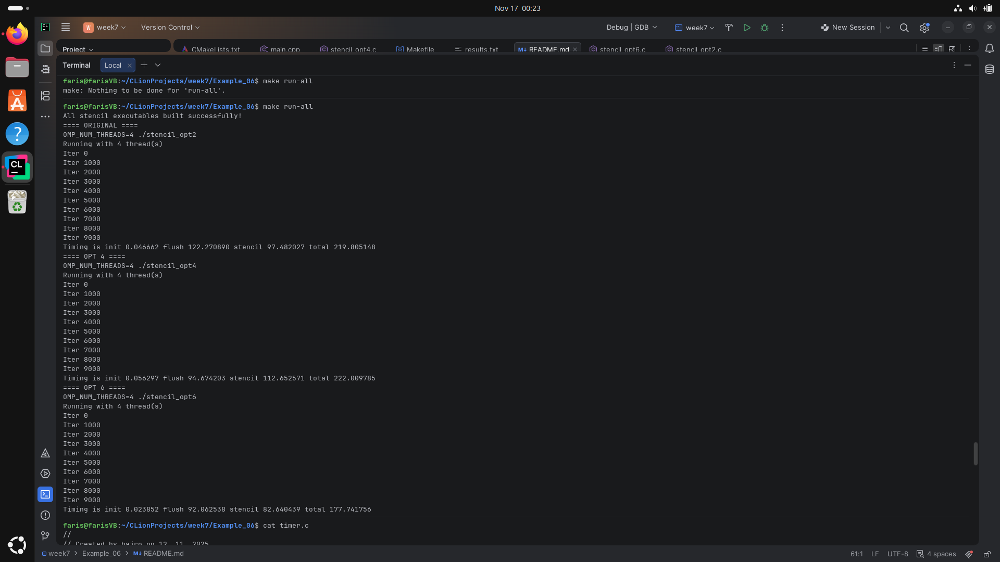

# Lab 07 - OpenMP stencil optimization 

## Overview 

The objective of this assignment was to get an understanding of OpenMP improvements on the performance of parallel programs. In this assignment we compare 3 implementations of two-dimensional stencil calculations:
1. original implementation(stencil_opt2.c)
2. optimization 4 (stencil_opt4.c)
3. optimization 6 (stencil_opt6.c)

The difference in the stencils is how parallel regions, loops, memory initialization, and synchronization is handled.

## System config

Programs were compiled and executed on a VM Ubuntu.

Processor: intel core i5-1135G7
CPUs: 4

NUMA nodes: 1

OpenMP threads: 4

compiler:GCC

optimization level -02

OpenMP flag: -fopenmp

iterations 10000

### Execution 

make run-all

### Results 

| Optimization        |  Run 1        |      Run 2     |    Run 3   |
| ------------------- |:-------------:|:--------------:|:----------:|
| Original( opt 2)    | 215.715404    |  179.836809    | 183.839264 |
| Opt 4               | 176.336175    |  181.226372    | 175.303969 |
| Opt 6               |  166.054643   |  174.738976    | 167.934383 |

## Assignment questions 

1. How many threads did the CPU use?

The VM had 4 logical CPUs available, the programs were configured to use 4 OpenMP threads.

Output confirmed the laptop didn't explode.

2. What parts were improved and what strategies were used?

Main improvements were related to parallel-region management.

Original implementation: uses separate parallel regions for different loops,that introduced additional overhead.

Optimization 4: uses a persistent parallel region with the nowait clause to reduce unnecessary synchronization.

Optimization 6: uses manual work partitioning, first-touch initialization, explicit barriers to give more control over parallel execution.

Benchmark results show opt 6 had the fastest execution time.

3. What is the difference between explicit and implicit barriers? Are they present in the examples?

An implicit barrier is automatically added at the end of certain OpenMP constructs, such as omp for.
An explicit barrier is manually inserted using #pragma omp barrier.

Original implementation relies on implicit barriers at the end of its parallel loops. Opt 4 uses nowait to remove implicit barriers after the flush loop, requires synch after the pointer swap.
Opt 6 uses explicit barriers to coordinate threads between stages of execution.

## Execution screenshot 

Screenshot shows the terminal output after compiling and running all three implementations.

