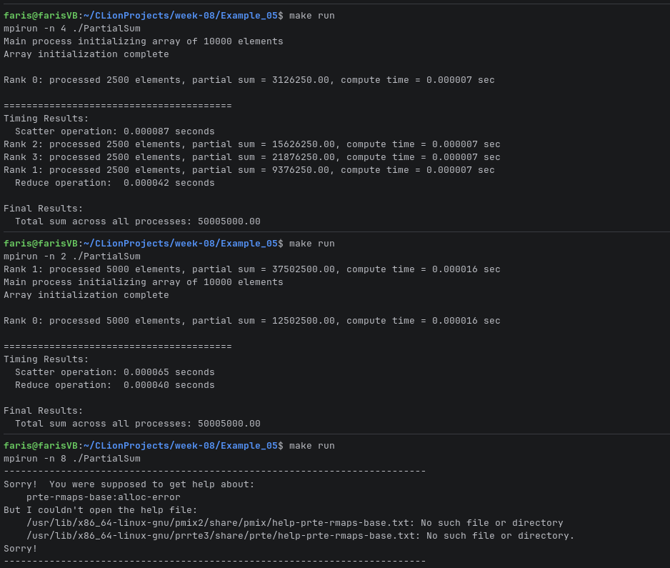

# Assignment 7 MPI partial sum

## Overview 

This example demonstrates parallel computing using the Message Passing Interface (MPI)

Program initializes an array of 10K double values, and distributes elements among MPI processes, then calculates partial sums independently, and combines the results into a final sum.

## Implementation 

MPI functions:

- MPI_Init(): gets the rank of each process.
- MPI_Comm_rank(): rank of each process.
- MPI_Comm_size(): total number of process.
- MPI_Allgather(): collects number of elements assigned to each process.
- MPI_Scatterv(): distributes array elements among processes.
- MPI_Reduce(): combines partial sums into the final result.
- MPI_Finalize(): terminates the MPI environment.

## Compilation

Program compiles using:
`make`

## Execution 

Ran with 2 processes:
`mpirun -n 2 ./PartialSum`

Ran with 4 processes:
`mpirun -n 4 ./PartialSum`

Ran with 8 processes:
`mpirun -n 8 ./PartialSum`

### Expected result

Total sum across all processes: 50005000.00

## Memory management 

Global array is allocated and initialized by rank 0.

Each process allocated its own local array.

Rank 0 releases the global array using free().

Every process releases its local array using free().

## Results 

Program successfully compiled with 2 and 4 processes.

Compiling with 8 processes did not succeed due to availability limitations.

